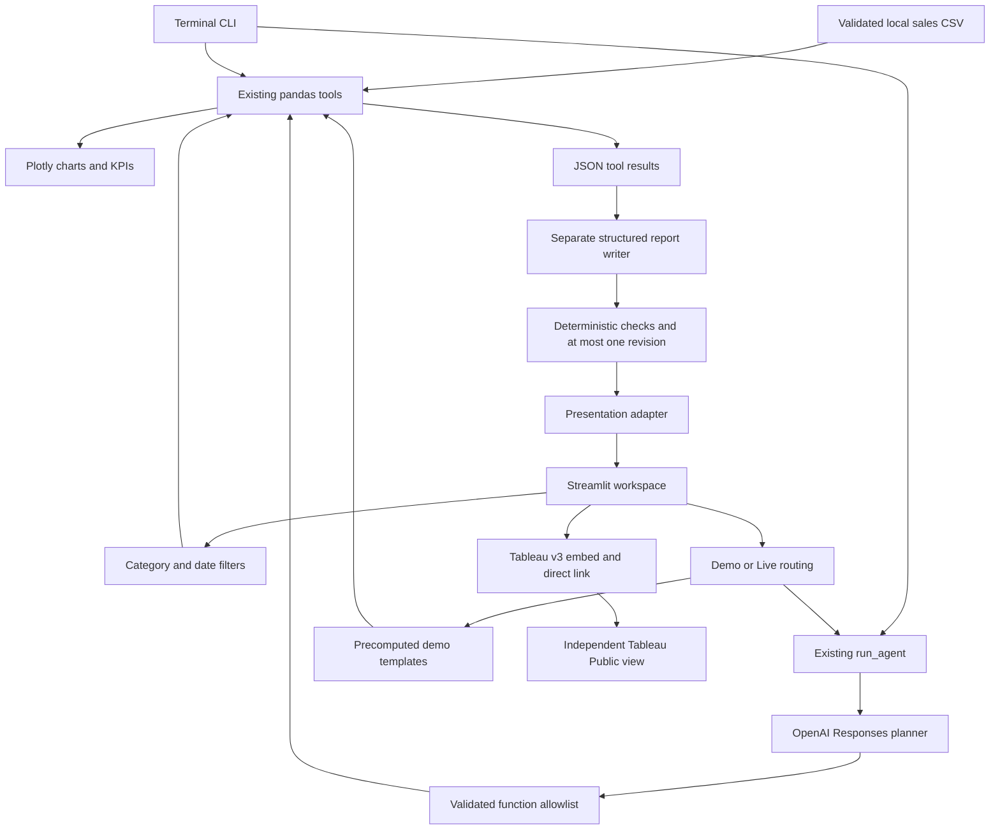

# ◈ InsightAgent

A retail analytics portfolio application connecting business questions to tested
Python calculations, interactive charts, and a published Tableau dashboard.

**Explore the data. Ask the analyst. Inspect the evidence.**

[Open the Tableau Public dashboard](https://public.tableau.com/views/InsightAgent-RetailSalesIntelligenceDashboard/InsightAgent-RetailSalesOverview)

## Three ways to explore

| Workspace | What it does | Data scope |
| --- | --- | --- |
| AI Analyst | Demo answers or live OpenAI planning, calculations, and verified reports | Complete local CSV |
| Sales Dashboard | Plotly charts with category and inclusive date filters | Selected local transactions |
| Tableau Intelligence | Embedded independent Tableau Public portfolio view | Published workbook's own data and controls |

The bundled fictional dataset contains **240 transactions**, **717 units sold**,
and **$12,951.00 revenue** across January–June 2025. Those values describe the full
dataset. Every local chart and KPI is recalculated from the selected dataframe.

## Quick start

Use Python 3.11 or newer. From the repository root, create a virtual environment.

```sh
python -m venv .venv
```

Activate it with `.\.venv\Scripts\Activate.ps1` in PowerShell or
`source .venv/bin/activate` on macOS/Linux.

```sh
python -m pip install -r requirements.txt
python -m streamlit run streamlit_app.py
```

Start in **Demo Mode**, choose a suggested question, and press **Run Analysis**.
Demo Mode uses precomputed explanations and actual calculations from validated data.
It makes no API calls and needs no credentials. After dependencies are installed,
the local analyst demo and Plotly dashboard work without internet. Tableau needs
internet access.

The original terminal interfaces remain available.

```sh
python app.py
python app.py --ask "Which category generated the most revenue?"
python -m pytest -q
```

## Live Mode setup

Copy `.env.example` to a local `.env` file. Set `OPENAI_API_KEY` there or in the
server's environment. Optionally set `OPENAI_MODEL`. An empty model value uses
`gpt-5.4-mini`. The application has no API-key input field and never displays keys.
`.env`, its variants, and `.streamlit/secrets.toml` are ignored by Git. Only the
empty `.env.example` is included.

Select **Live Mode** and run a question. This calls the existing `run_agent()`
implementation. Each question starts an independent analysis. The latest five
analyses stay in session memory with their mode and evidence scope attached.

Suggested questions include

- Which category generated the most revenue?
- Show monthly revenue trends.
- What are the top five products by revenue?
- What is total revenue?

Dashboard filters affect only Sales Dashboard. They do not affect AI Analyst or
Tableau. Local CSV changes invalidate cached validation and clear displayed analyses.

## Architecture



| Module | Responsibility |
| --- | --- |
| `tools.py` | Existing validation and deterministic sales analysis |
| `agent.py` | Existing planner, controlled execution, writing, and reflection |
| `app.py` | Existing terminal report and `--ask` interface |
| `dashboard.py` | Pure filters, consistent KPI calculations, and Plotly figures |
| `presentation.py` | Report section adapter, curated demo answers, and mode routing |
| `streamlit_app.py` | Navigation, session state, accessible controls, and report display |
| `tableau.py` | Fixed public dashboard URL, v3 embed, and fallback |
| `generate_data.py` | Reproducible fictional CSV generator |

The Live planner selects real calls to `total_revenue`, `category_sales`,
`monthly_revenue`, and `top_products`. Strict empty-object schemas and an explicit
allowlist reject arbitrary functions, paths, and arguments. Responses continuation
returns each calculation through a matching `function_call_output` ID and retains
reasoning items. Execution is bounded to four tool rounds.

A separate writing request uses strict Structured Outputs for insights,
recommendations, and limitations. Complete fact references bind values to labels and
units. Metric references must be standalone insight entries and render as natural,
complete sentences such as “Electronics generated $4,196.50 in revenue from 184 units
sold.” Inline metric substitution is rejected. Monetary output uses USD with commas
and two decimal places. The UI shows the summary insight once and lists only distinct
additional insights. Deterministic verification rejects unsupported explicit numerical claims,
allows one revision, then removes and flags unverified statements. The UI adapts
these report sections without rewriting the agent's claims. Qualitative
interpretations still require human review.

## Technology stack

Python, pandas, Streamlit, Plotly, the official OpenAI Python SDK, python-dotenv,
pytest, and the existing Tableau Public dashboard. The application runs locally.

## Data and metric definitions

`data/sales.csv` contains date, order_id, product, category, quantity, and unit_price.
Run `python generate_data.py` to recreate it using a fixed seed.

Validation rejects missing columns, bad dates, nonpositive or fractional quantities,
negative/nonfinite prices, empty datasets, duplicate order IDs, and missing labels.
Revenue equals quantity multiplied by unit price. Monetary output uses two decimal
places. Units sold is the sum of quantities. A transaction is one CSV row.

Dashboard dates are inclusive. An empty category selection produces zero metrics
and an explicit empty state. Monthly gaps between the first and last matching sale
are filled with zero. Filtered partial months show only their matching sales.
Top products are ranked by revenue with alphabetical tie-breaking.

## Tableau integration

The Tableau page loads the published dashboard with the supported
[Tableau Embedding API v3](https://help.tableau.com/current/api/embedding_api/en-us/docs/embedding_api_basic.html).
A direct link remains visible if scripts, cookies, or the remote view are blocked.
The embed reports loading failures or a prolonged load. This view is an independent
portfolio component with its own data, refresh behavior, and controls.

## Testing and evaluation

```sh
python -m pytest -q
python app.py
```

Default tests use scripted clients and mocked SDK HTTP transport. They make no real
OpenAI requests. The suite preserves the original pandas and agent tests and adds

- Hand-calculated filtered KPIs, inclusive dates, empty selections, and chart values
- Report claim preservation and explicit demo/live routing
- Streamlit AppTest checks for demo analysis, mocked live dispatch, dashboard filters,
  empty states, and Tableau fallback presentation
- Existing byte-identical dataset regeneration and strict report-request regression checks

`evaluations.json` contains twelve questions with expected tools or answer facts.
Offline tests verify the execution contract, not live model quality. For a live
evaluation, run each question with `--ask` and compare its tools and answer against
the case. Live API behavior and browser-only interactions require separate checks.

## Presentation and screenshots

Use [the three-minute beginner demo](docs/nontechnical_demo.md) or
[the five-minute technical walkthrough](docs/technical_walkthrough.md).

For portfolio screenshots, run the app at a desktop viewport and capture

1. Sales Dashboard with all categories and dates, all three KPIs, and charts
2. AI Analyst after the category question in clearly labeled Demo Mode
3. Tableau Intelligence after the external view loads, keeping the direct link visible

Use actual running-app captures. Show the selected filters and mode, and remove any
private browser content. For a narrow-window check, confirm stacked controls, readable
charts, and accessible navigation. Screenshots are not bundled with this change.

## Costs, privacy, and limitations

Live questions send the question and aggregate calculation results to OpenAI.
Supported questions usually require three requests and can require up to seven.
Each response is capped at 1,800 output tokens. Requests have a 30-second timeout
and no automatic SDK retries. Repeated conversation input also costs tokens.
Review [current model pricing](https://developers.openai.com/api/docs/models/gpt-5.4-mini)
before a live demo.

No API key was available during development. Live model quality remains pending
verification. Tests simulate the SDK boundary and do not establish production API
availability. Browser rendering and Tableau loading can vary with browser policy,
network access, and the independently published workbook.

The dataset supports descriptive revenue and units. It lacks costs, customer
records, inventory levels, and causal evidence. Profit, forecasts, and reasons for
changes are unsupported. The model's unsupported-question classification and its
qualitative statements still need review. Demo Mode answers only curated questions.

This is a local portfolio application with no authentication, deployment, or
multiuser access controls. Avoid exposing a credential-backed local server publicly.
The pandas arithmetic is retained from the existing implementation and displayed
to cents.

Implementation references include the official
[Responses function-calling guide](https://developers.openai.com/api/docs/guides/function-calling)
and [Structured Outputs guide](https://developers.openai.com/api/docs/guides/structured-outputs).

