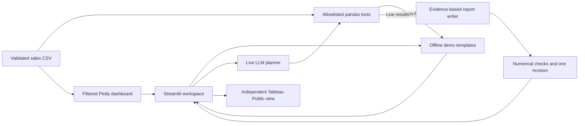

# InsightAgent

**An AI retail analyst with inspectable calculations and interactive business dashboards.**

InsightAgent turns retail sales questions into Python calculations, concise reports,
and visual evidence. It combines a Streamlit workspace, Plotly exploration, an
OpenAI-powered analyst, and an independently published Tableau Public dashboard.

[Explore the Tableau dashboard](https://public.tableau.com/views/InsightAgent-RetailSalesIntelligenceDashboard/InsightAgent-RetailSalesOverview)
· [Beginner demo](docs/nontechnical_demo.md)
· [Technical walkthrough](docs/technical_walkthrough.md)
· [Portfolio copy](docs/portfolio.md)

## What you can explore

| Feature | Experience |
| --- | --- |
| **AI Analyst** | Ask a business question and inspect the answer, metrics, tools, recommendations, and limitations. |
| **Demo Mode** | Try four clearly labeled, precomputed answers based on validated sales data, without an API key. |
| **Live Mode** | Let an OpenAI model select and execute trusted Python tools, then write a report from their results. |
| **Sales Dashboard** | Explore revenue, transactions, units, category sales, monthly trends, and leading products with interactive Plotly charts. |
| **Tableau Intelligence** | View the independent Tableau Public dashboard through an embed or open the full dashboard directly. |
| **Terminal interface** | Run the deterministic report or ask the same live analyst from the command line. |

Dashboard category and date filters apply to every local dashboard KPI and chart.
AI Analyst uses the complete CSV. Tableau has its own data and controls.

## Try it locally without an API key

Use Python 3.11 or newer and a terminal. Verification for this revision used Python
3.15 on Windows. Other Python versions and operating systems have not been tested
for this revision.

```sh
git clone https://github.com/mayukh29-dev/insight-agent.git
cd insight-agent
python -m venv .venv
```

Activate the virtual environment.

| Terminal | Command |
| --- | --- |
| Windows PowerShell | `.\.venv\Scripts\Activate.ps1` |
| Windows Command Prompt | `.venv\Scripts\activate.bat` |
| macOS / Linux | `source .venv/bin/activate` |

Then install dependencies and start the application.

```sh
python -m pip install -r requirements.txt
python -m streamlit run streamlit_app.py
```

1. Open the local address printed by Streamlit.
2. Select **AI Analyst** and leave **Demo Mode** selected.
3. Choose **Which category generated the most revenue?** from the suggested questions.
4. Click **Run Analysis**. The demo identifies Electronics with **$4,196.50** in revenue.
5. Open the metrics, limitations, and underlying tools to inspect the evidence.
6. Switch to **Sales Dashboard** to explore charts and filters.

Demo Mode needs no `.env` file, OpenAI account, or API credits. It uses prepared
explanations with calculated facts, and labels that no AI request was made. After
installation, the local demo and sales dashboard can run offline. Tableau requires
internet access. Repository access is required to clone a private repository.

## How the agent works

Live Mode uses the OpenAI Responses API and executes model-selected function calls.

1. **Plan.** The model chooses from four explicit tool schemas for total revenue,
   category sales, monthly revenue, and top products.
2. **Execute Python tools.** An allowlist validates tool names and empty-object
   arguments before running the existing pandas functions on the trusted dataframe.
3. **Return evidence.** Calculated results are serialized as JSON and returned with
   matching function-call IDs. The conversation preserves response items for continuation.
4. **Write the report.** A separate Structured Outputs request produces insights,
   recommendations, and limitations using only the calculation results.
5. **Verify numerical claims.** Metric references bind exact values to labels and
   units. They render as complete sentences, such as “Electronics generated
   $4,196.50 in revenue from 184 units sold.” Inline metric substitutions and explicit
   model-authored numerical claims are rejected.
6. **Reflect once.** Verification issues can trigger one revision. Remaining
   unverified statements are removed and flagged.

Tool execution is bounded to four rounds. Each question is independent.
Qualitative interpretation still requires human review.

## Architecture



The report-writing and verification path belongs to Live Mode. Demo Mode uses the
pandas tools with prepared answer templates. The terminal interface reuses the same
analysis functions and live agent.

| Component | Responsibility |
| --- | --- |
| `tools.py` | CSV validation and deterministic pandas analysis |
| `agent.py` | Planning, safe function dispatch, report writing, and reflection |
| `dashboard.py` | Inclusive filters, KPI calculations, and Plotly figures |
| `presentation.py` | Report adapter, demo answers, and mode routing |
| `streamlit_app.py` | Three-section UI, session history, and evidence display |
| `tableau.py` | Fixed published view, v3 embed, and direct-link fallback |
| `app.py` / `generate_data.py` | CLI entry point and reproducible data generation |

## Optional Olist historical data (Phase 1)

An independent ingestion pipeline prepares weekly BRL item-price revenue from
Olist's public 2016–2018 history. See [download instructions and definitions](docs/olist.md).
It does not change the synthetic demo, CLI, Live Mode, dashboards, or Tableau.
No forecasting model is trained in this phase.

Phase 2 adds an optional [weekly forecasting experiment](docs/forecasting.md):
reconciled historical BRL totals, two simple baselines, a reproducible ridge model,
and chronological backtests. Run it separately with `python -m olist.forecast`;
the existing application and demo stay unchanged.

## Technology stack

| Layer | Technology |
| --- | --- |
| Language and analysis | Python, pandas |
| Web interface and charts | Streamlit, Plotly |
| Live AI integration | Official OpenAI Python SDK, Responses API, Structured Outputs |
| Configuration | Environment variables, python-dotenv |
| Testing | pytest, Streamlit AppTest, scripted clients, mocked SDK HTTP transport |
| Independent visualization | Tableau Public |

## Live Mode and CLI examples

Copy `.env.example` to a local `.env` file and set `OPENAI_API_KEY`, or supply the
key through the server environment. Optionally set `OPENAI_MODEL`. An empty value
uses the configured default, `gpt-5.4-mini`. Select **Live Mode** in Streamlit.

```sh
python app.py
python app.py --ask "Which category generated the most revenue?"
python app.py --ask "Show monthly revenue trends."
python app.py --ask "What are the top five products by revenue?"
```

The first command runs the deterministic report without credentials. The `--ask`
commands make live API requests and incur OpenAI charges. The same four sample
questions, including “What is total revenue?”, are available in Demo Mode.

## Synthetic dataset and verified metrics

`data/sales.csv` contains 240 fictional transactions across eight products and four
categories from January through June 2025. Each row includes `date`, `order_id`,
`product`, `category`, `quantity`, and `unit_price`.

| Full-dataset metric | Verified value |
| --- | --- |
| Total revenue | **$12,951.00 USD** |
| Transactions | **240** |
| Units sold | **717** |
| Leading category by revenue | **Electronics · $4,196.50 USD** |
| Leading product by revenue | **Wireless Mouse · $3,152.50 USD** |

Revenue is quantity × unit price. Units sold is the sum of quantities. All monetary
figures are displayed to two decimal places. These figures describe the bundled
synthetic dataset and do not represent results achieved by a real business.

Run `python generate_data.py` to recreate the CSV using its fixed seed. Validation
rejects missing columns, invalid dates, invalid quantities, negative or nonfinite
prices, missing labels, duplicate order IDs, and empty data.

Dashboard dates are inclusive. Empty selections show zero KPIs and an explicit
empty state. Monthly gaps between the first and last matching sale are filled with
zero, and filtered partial months contain only their matching transactions.
Product revenue ties are broken alphabetically.

## Testing and evaluation

```sh
python -m pytest -q
python -m pip check
```

The automated suite covers hand-calculated analysis results, validation failures,
filters and chart values, actual tool dispatch, multiple calls, iteration limits,
API failures, numerical verification, reflection, report readability, and
Streamlit interactions. Default tests use fake clients and mocked HTTP transport,
so they make no real OpenAI requests.

`evaluations.json` contains twelve questions with expected tools or answer facts.
These offline cases test execution contracts and known answers. They do not
establish live model-selection accuracy. Live evaluation requires running the
questions with `--ask` and reviewing their tools, answers, and limitations.

## Limitations and security

- **Evidence scope.** The data supports descriptive revenue and units. It lacks costs,
  customers, stock levels, and causal evidence. Profit, forecasts, and explanations
  for changes are unsupported.
- **Verification scope.** Deterministic checks constrain explicit numerical claims.
  They cannot prove every natural-language interpretation or identify every
  possible misleading statement. Recommendations require human judgment.
- **Demo scope.** Demo Mode answers curated questions. Live questions each use the
  complete dataset and do not inherit dashboard filters or previous-question context.
- **Credentials.** API keys stay in the server environment or local `.env`.
  Git ignores `.env` variants and `.streamlit/secrets.toml`. The committed
  `.env.example` contains empty variable assignments only.
- **Execution boundary.** The model cannot execute generated Python, shell commands,
  or arbitrary filesystem operations through the tool interface. API error messages
  are sanitized before display.
- **Privacy and cost.** Live Mode sends the question and aggregate calculation
  results to OpenAI. It has a 30-second request timeout, no automatic SDK retries,
  and an output-token cap. Review API pricing before using Live Mode.
- **External and local operation.** Tableau availability depends on internet access
  and browser policy. This local portfolio app has no authentication or hosted
  multiuser controls.
- **Remaining verification.** Live API quality, browser-level layout, Plotly hover
  interactions, and Tableau embed loading have not been verified in this environment.

For a short presentation, use the [three-minute beginner demo](docs/nontechnical_demo.md)
or [five-minute technical walkthrough](docs/technical_walkthrough.md). Repository
description, suggested topics, and resume bullets are in [the portfolio file](docs/portfolio.md).
