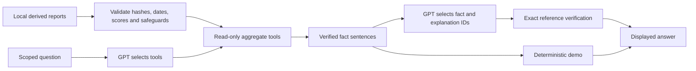

# Phase 4: AI Forecast Analyst

The Olist workspace now has a **separate, optional Forecast Analyst** below its
charts. It explains saved historical BRL results without changing data or retraining
models. The original fictional USD agent in `agent.py` is unchanged.

## Key-free demo and recruiter walkthrough

Prepare the three derived files using [the historical dashboard guide](historical_dashboard.md),
then select **Olist historical forecasts**. **Enable Forecast Analyst** is off by
default. When enabled, it starts in **Demo**, without an API key or external call.

1. Select “Which method has the lowest historical error?” and press **Ask Forecast
   Analyst**. Read the saved baseline/ridge comparison; do not presume ridge wins.
2. Ask why the historical illustration is unavailable. A suppressed report shows
   its reason codes and no point amount—not even a replacement zero.
3. Ask about source coverage. Explain that recorded zeros are retained and calendar
   completeness does not establish source completeness.
4. Open tool evidence. Show the named read-only tool and references behind the
   displayed facts, rather than a model-generated number or reasoning transcript.

Demo supports the suggested questions and the exact template
`What is recorded revenue for week YYYY-MM-DD?` for a covered Monday. Other demo
questions show guidance. Chart filters do not filter analyst evidence. A mode or
source-content change clears a previous answer so stale predictions do not remain.

## Optional Live AI

Keep `OPENAI_API_KEY` in the **server environment** or ignored local `.env`, using
the existing `.env.example` as a guide. Never put a key into questions, UI widgets,
Git, screenshots or docs. Select **Live AI** and submit a question; merely selecting
the mode makes no request. It uses **`gpt-5.4-mini`**, independently of the original
agent's `OPENAI_MODEL`. Missing credentials or provider errors leave Demo available.

Live mode accepts scoped natural-language questions about historical revenue,
model errors, coverage and illustration status. A specific week must be a covered
Monday. Other currencies, current-business results, profit/customer requests,
unsupported dates and obvious injection/secret/identifier patterns are declined.
This input screen is a scope aid, **not a universal PII detector or the security
boundary**. Do not paste personal data or credentials: your accepted question and
bounded aggregate facts are sent to OpenAI. Tools send no raw records, order/customer
IDs, full CSVs, arbitrary quality-warning prose, coefficients or source file paths.

## Architecture in beginner language

Think of the local report as a checked worksheet. The planner chooses a small
read-only section. A separate writer chooses verified fact references and approved
explanations. Python renders the final sentences and every number. The model never
gets to invent a value or causal story that the application will display.



`olist/forecast_agent.py` reuses `olist.dashboard.validate_dashboard` before either
mode or any API call: schema v2, input/producer hashes, cent reconciliation, target
alignment, actuals, score/selection recomputation and coverage/availability rules.
Missing, stale or inconsistent files fail closed. Changed files during an API
answer discard the answer. Hashes check consistency, not external authenticity.

| Strict tool | Bounded evidence |
| --- | --- |
| `get_forecast_scores` | Common evaluation dates/count, three error rows, winner and baseline comparison. |
| `get_historical_week` | One requested covered Monday's recorded actual, explicitly labeled partial when relevant. |
| `get_historical_summary` | Reconciled recorded historical revenue total and observed week count. |
| `get_coverage_warnings` | Partial/zero/outlier counts, recent-coverage status and reconciliation caveat. |
| `get_forecast_availability` | Saved status/reasons; selected illustrative point only when permitted. |

The model cannot supply a path, arbitrary code, SQL, network request or unbounded
range. Python validates arguments even with strict tool schemas. Function-call IDs
must be unique and match outputs. Responses continuation carries output items
internally, but planner text and reasoning are never rendered or stored in the
user-facing answer. See the official [function-calling guide](https://developers.openai.com/api/docs/guides/function-calling).

The writer uses [Structured Outputs](https://developers.openai.com/api/docs/guides/structured-outputs)
containing only arrays of fact IDs and approved interpretation/recommendation IDs.
Python checks exact keys, membership, uniqueness and lengths. Arbitrary model-authored
prose is rejected, including number-free invented causation. Wrong BRL labels, dates,
numeric claims or extra summary fields cannot pass as a verified reference. There
is at most one repair, without echoing the unsafe draft; repeated failure falls
back to deterministic evidence and explanations. This deliberately limits expressive
freedom: AI selects evidence and explanations, while templates render sentences.
The model supports these API features; see the [GPT-5.4 mini documentation](https://developers.openai.com/api/docs/models/gpt-5.4-mini).

All displayed amounts, dates, winner and reason codes come from validated facts.
Metric display rounds to two decimals; the saved report retains original score
precision. Historical weekly amounts use integer centavos. When the illustration is
unavailable, no tool returns its numeric point, placeholder zero or alternative-method
point, and mandatory status/reason facts cannot be omitted. Actual historical revenue
and MAE amounts may still appear with their correct labels; they are not forecasts.

Mandatory limitations always explain BRL item-price revenue (excluding freight,
not net of refunds), historical scope, WAPE as error rather than accuracy, shared
selection/scoring data, unknown source completeness and lack of causal evidence.

## Cost and public hosting

Each answer is bounded: question at most 500 characters; up to four requested dates;
two tool rounds; four calls per round and six overall; at most five API requests
including the finish and one repair. Each request caps output at 1,200 tokens and
serialized input at 32,000 characters. SDK timeout is 20 seconds/request, automatic
retries are disabled, and every request uses `store=False`. Unverified text is not
streamed, and live answers are not shared in a cross-user cache.

These are **per-answer bounds, not global rate or spend controls**. No authentication,
per-user rate limit, concurrency quota or hard monetary limit is implemented. For a
public showcase, run Demo with no server key. Before hosting with a paid key, add
authentication, server-side request/concurrency quotas and provider/project cost
controls appropriate to the deployment. An off-by-default toggle is not access
control. Provider retention policies are separate from `store=False`; no zero-retention
claim is made. This phase does not deploy a paid public service.

## Local real-data validation

Real Olist files are unavailable in this development checkout. Tests use tiny fictional
fixtures and mocked provider calls, including SDK MockTransport; no paid request or
real-provider quality claim is made. In PowerShell, after placing the four licensed
source files locally according to the ingestion guide:

```powershell
& .\.venv\Scripts\python.exe -m pip install -r requirements.txt -r requirements-forecast.txt
& .\.venv\Scripts\python.exe -m olist --source .\data\olist\raw --output .\data\olist\processed
& .\.venv\Scripts\python.exe -m olist.forecast --input .\data\olist\processed\weekly_revenue.csv --quality .\data\olist\processed\quality_report.json --output .\data\olist\processed\forecast_results.json
& .\.venv\Scripts\python.exe -m pytest -q
& .\.venv\Scripts\python.exe -m pip check
$report = Get-Content .\data\olist\processed\forecast_results.json -Raw | ConvertFrom-Json
$report.scores | ConvertTo-Json -Depth 5
$report.selection
$report.next_week_illustration | ConvertTo-Json -Depth 5
& .\.venv\Scripts\python.exe -m streamlit run streamlit_app.py
```

Start with Demo and compare scores/winner against your JSON. On the reviewed extract,
check the October 2018 partial target and unreliable tail: no illustrative amount
may appear. Never hardcode the example scores. Then, if desired, privately configure
the server key, restart Streamlit and explicitly submit Live AI; that incurs charges.
Do not commit raw data, generated reports or secrets. Real-data/live-provider smoke
testing and browser visual review remain local follow-ups, not completed claims.

Development verification: **266 tests passed**, including 55 Forecast Analyst cases.
Dependency checks and type checks on the edited modules passed. Running-app QA used
a fictional partial-target report to verify opt-in Demo, suggested-question callbacks
and unavailable explanations without any point amount. No new console warnings or
paid API calls were observed. Real-data and real-provider quality remain unverified.
